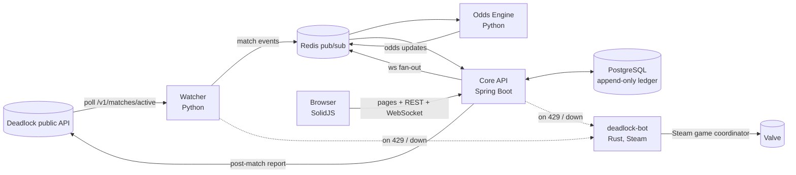
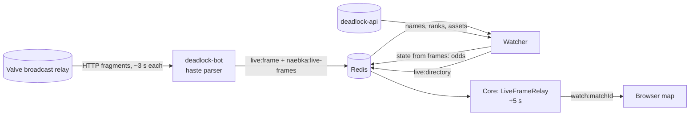

# Naebka

Live betting on real public **Deadlock** matches, plus **slots** and multiplayer **No-Limit Hold'em**, all on one
token wallet with an append-only ledger. Implementation of the group's design documents in this folder
(High-Level Design, System Architecture, Technical Design, LLD, Database Design, Frontend, Risks).

Runs in **play-money mode**: tokens are free and have no cash value.

## Run it

Requirements: Docker Desktop. Nothing else needs to be installed.

```bash
docker compose up --build
```

Open <http://localhost:8080>, register (18+, licensed country), and you start with 1,000 NTK.
To withdraw, verify your identity under **Profile & verification** in the account menu (see [KYC](#kyc)).
Live matches appear within ~10 s: the watcher picks fresh ranked games from `api.deadlock-api.com`.

| Service | Port (host) | What it is |
|---|---|---|
| `core` | 8080, 8081 | Spring Boot: serves the SolidJS frontend, `/api` and `/ws` (Swagger UI: <http://localhost:8081/api/docs>) |
| `postgres` | 55432 | PostgreSQL 17 (non-default port so it doesn't clash with a local install) |
| `redis` | 56379 | Redis 7: message broker and WebSocket fan-out |
| `watcher` | – | Python: polls the Deadlock API and publishes normalized match events |
| `odds-engine` | – | Python: prices markets from the event stream |
| `deadlock-bot` | – | Optional (`--profile bot`). Rust Steam bot: follows match broadcasts for the [realtime map](#live-matches-and-the-realtime-map) and answers when deadlock-api says "too many requests" ([below](#steam-bot-fallback)) |

The admin account (manual-review queue and integrity dashboard at `/admin`) comes from `.env.example`
(`NAEBKA_ADMIN_USERNAME` / `NAEBKA_ADMIN_PASSWORD`). Copy it to `.env` to change values.

**Production** (<https://poker.naebka.win>): every push to `main` is tested, built and deployed by GitHub Actions;
see [deploy/README.md](deploy/README.md). Each push is a release whose version number (shown under the name in the
header) goes up by what was merged: see [docs/versioning.md](docs/versioning.md).

## MetaMask + Sepolia deposits and withdrawals (web3)

Players connect MetaMask, deposit **Sepolia test ETH** to get play tokens (0.001 ETH = 100 NTK by default), and
withdraw tokens back to their wallet as Sepolia ETH. Sepolia ETH has no value, so the platform stays in `PLAY_MONEY`
mode. It follows the course web3 lab: the same Remix settings, the Sepolia chain check (11155111 / `0xaa36a7`), and
the connection safeguards from the lab's `shared/wallet.js` (ported to `frontend/src/lib/eth.ts`).

Deposits are off until a cashier contract address is configured; withdrawals also need an operator key.

### The contract: `contracts/src/NaebkaCashier.sol`

| Function | Who and what |
|---|---|
| `deposit()` | Anyone, 0.0001–0.05 ETH. Emits `Deposited(player, amount)`, which the core credits. Plain transfers are rejected. |
| `payout(to, amount, withdrawalId)` | The **operator** (the server's key) or the owner. At most 0.05 ETH per payout and `dailyPayoutLimit` (0.5 ETH) per UTC day; each `withdrawalId` is paid once. |
| `pause()` / `unpause()` | The operator or the owner can pause (deposits and payouts stop); only the owner resumes. |
| `setOperator`, `setDailyPayoutLimit`, `fund`, `withdrawHouse` | Owner only. |
| `transferOwnership` → `acceptOwnership` | Two steps, so ownership can't be lost to a typo. |

The operator exists so the server never holds the owner key: the owner stays in MetaMask, and a leaked server key
could pay out at most the daily limit before someone pauses the contract.

Tests (17, Hardhat; no local Node needed):

```bash
docker run --rm -v "$PWD/contracts:/app" -w /app node:22-alpine sh -c "npm ci && npx hardhat test"
```

### 1. Deploy the contract (once)

**From Remix** (as in the lab):

1. Open `contracts/src/NaebkaCashier.sol` in [Remix](https://remix.ethereum.org). Compiler **0.8.24**, optimiser on,
   **200 runs**, EVM **Shanghai**.
2. Test in Remix VM first: `deposit` with Value 0.001 ether works; Value 0 or 1 ether reverts `AmountOutOfRange`;
   `payout` from a second account reverts `OnlyOperator`, and works after `setOperator(<second account>)`.
3. Switch the environment to **Browser Extension** (MetaMask on Sepolia) and deploy with **Value = 0**. The deploying
   account becomes `owner`.
4. Copy the contract address from *Deployed Contracts* (not the account address or the transaction hash), and the
   block number of the deployment transaction from Etherscan.
5. For withdrawals: create a second MetaMask account for the server (the operator) and send it a little Sepolia ETH
   for gas. Call `setOperator(<its address>)`, then `fund` the contract with some Sepolia ETH (Value = 0.2 ether, say).

**Or with Hardhat**: `contracts/scripts/deploy.js` does steps 3–5 and prints the `.env` lines:

```bash
docker run --rm -v "$PWD/contracts:/app" -w /app \
  -e DEPLOYER_PRIVATE_KEY=0x... -e OPERATOR_ADDRESS=0x... -e FUND_ETH=0.2 \
  node:22-alpine sh -c "npm ci && npm run deploy:sepolia"
```

`contracts/NaebkaCashier.abi.json` is the compiled ABI (`npm run abi` regenerates it), for Remix "At Address" or
Etherscan.

### 2. Configure and start

```bash
cp .env.example .env
# deposits:    NAEBKA_ETH_CONTRACT_ADDRESS=0x...  NAEBKA_ETH_DEPLOY_BLOCK=<block>
# withdrawals: NAEBKA_ETH_OPERATOR_KEY=0x<private key of the operator account>
docker compose up --build
```

The operator key must belong to a **Sepolia test account only**. It pays the gas for payouts; the ETH itself comes
from the contract. Never use a key that holds real money. Optional: `NAEBKA_ETH_RPC_URL` (default: the public
`ethereum-sepolia-rpc.publicnode.com`; an Infura or Alchemy Sepolia URL is more reliable),
`NAEBKA_ETH_TOKENS_PER_ETH`, `NAEBKA_ETH_CONFIRMATIONS` (default 3), `NAEBKA_ETH_MAX_FEE_GWEI` (default 50).
If players open the site at an address other than `http://localhost:8080`, set `NAEBKA_ETH_SIWE_DOMAIN` and
`NAEBKA_ETH_SIWE_URI` to match, or MetaMask warns that the sign-in message is for another site.

### 3. Play

Wallet page → **Sepolia test ETH** card:

1. **Connect MetaMask** (switch to Sepolia if asked).
2. **Link this address**: MetaMask asks you to sign a Sign-In with Ethereum message. Signing is free and sends no
   transaction; it proves you hold the key, so nobody can link your address to their account.
3. **Deposit**: approve the transaction. The Etherscan link appears as soon as it is submitted. The core credits the
   tokens once the block is 3 confirmations deep (about a minute).
4. **Withdraw** (needs a verified identity, like every withdrawal): enter an amount in NTK. The tokens are taken at
   once, and the ETH arrives at the linked address within a minute or two. MetaMask doesn't have to be open: the server
   sends the transaction.

How it works:

* `eth/EthDepositPoller` polls `eth_getLogs` for `Deposited` events. It saves the events of a block range and its
  "last processed block" cursor in one database transaction, so after a crash the range is read again and the
  unique (chain, tx, log index) key turns the repeat into a no-op. It deliberately does not use Redis pub/sub,
  which drops messages while the core is down.
* `eth/EthDepositService` credits through `WalletService` with the idempotency key
  `deposit:eth:<chain>:<tx>:<logIndex>`, so the append-only ledger, responsible-gambling limits and the KYC deposit
  cap all apply (the `deposit:` prefix is what the KYC cap counts). A deposit from an address nobody has linked
  waits as `unlinked` and is credited when someone links it. A deposit over a deposit limit or the unverified KYC
  cap, during self-exclusion, or above the max single deposit is `held`. The ETH is already on chain, so it is kept,
  never refused.
* `eth/EthWithdrawalService` takes the tokens with the ledger key `withdrawal:eth:<user>:<Idempotency-Key>` and
  stores a `pending` withdrawal in the same transaction, so a retried request never takes them twice.
* `eth/EthPayoutSender` pays one withdrawal at a time. It first asks the node to estimate `payout()`: if the contract
  would refuse (paused, daily limit, not enough ETH in it, operator not set), the withdrawal waits and shows why. It
  signs an EIP-1559 transaction with the operator key (`eth/EthPayout`), saves it as `sent` with its hash, and only
  then broadcasts it. Mined and 3 blocks deep: `confirmed`. Reverted: `failed` and the tokens are refunded, unless
  `paid(withdrawalId)` on the contract says an earlier transaction paid it. Not mined in 5 minutes: broadcast again.
  Not mined in an hour: `review`.
* Admins see unlinked and held deposits, open withdrawals, the operator's and the contract's balances, and the pause
  state at `GET /api/admin/eth`. `POST /api/admin/eth/deposits/{id}/retry` re-runs a deposit's checks (for example
  after the player is KYC-verified). `POST /api/admin/eth/withdrawals/{id}/retry` sends a withdrawal in review again;
  the contract refuses to pay the same id twice.

Lab-style test (accounts A and B in MetaMask, both with Sepolia ETH; the contract has an operator and some funds):

| Step | Account | Action | Expected |
|---|---|---|---|
| 1 | A | Connect, link, deposit 0.001 ETH | +100 NTK after ~1 min, status `credited` |
| 2 | B | Deposit from Remix without linking | Status `unlinked` (admin view), no tokens |
| 3 | B | Log in as a second user, link B | The waiting deposit is credited at once |
| 4 | A | Deposit 0.00001 ETH | MetaMask/Remix rejects: `AmountOutOfRange` |
| 5 | B | `payout` in Remix | `OnlyOperator` |
| 6 | A | Set a 1 NTK daily deposit limit, deposit 0.001 ETH | Status `held` with the limit reason |
| 7 | A | Link A to the second user too | `ADDRESS_TAKEN` |
| 8 | A | New unverified user (no limits), link A, deposit 0.03 ETH (3,000 NTK) | `held`: over the 2,000 NTK KYC cap; after KYC verification an admin retry credits it |
| 9 | A | Verified user withdraws 100 NTK | −100 NTK at once; `paid` with an Etherscan link after ~1 min; +0.001 ETH in MetaMask |
| 10 | owner | `pause()` in Remix, then A withdraws | Stays `queued` with "The cashier contract is paused"; paid after `unpause()` |
| 11 | A | Unverified user withdraws | `KYC_REQUIRED` |

## Architecture



* **Transactional core** (modular monolith): auth, wallet/ledger, responsible gambling, live betting, settlement
  worker, slots, poker, chat, WebSocket hub. Packages only touch money through `WalletService`.
* **Event-driven live data**: the watcher knows nothing about odds or money; the odds engine knows nothing about
  users. Everything Deadlock-specific lives in `live/naebka_live/deadlock_api.py` + `watcher.py`.

### The live-betting loop

1. **Discover**: the watcher keeps up to 8 fresh Normal-mode matches (best rank first), and re-announces them every
   minute so a restarted core picks them up.
2. **Ingest**: each 10 s poll is diffed into `objective.destroyed`, `networth.swing`, `match.ended` or
   `match.snapshot`.
3. **Suspend first**: on a state-changing event the core immediately moves every OPEN market to SUSPENDED.
4. **Reprice**: the odds engine waits a 5 s cooling-off, prices the new state and publishes. The core writes
   `odds_history` and reopens the market (plausibility band 1.01–51.0, otherwise it stays suspended).
5. **Bet**: `POST /api/bets` re-validates after a 1.5 s acceptance delay under a row lock. If the price moved you
   get `409 PRICE_CHANGED` (or the bet takes the better price if you allowed higher odds).
6. **Settle**: when the match ends, the settlement worker fetches `/v1/matches/{id}/metadata`. If it agrees with the
   stream, payouts go to the ledger. On a mismatch or data-quality flag, or if no report arrives within 3 h, the
   match goes to the manual-review queue.
7. **Watchdogs**: no watcher data for 60 s → STALE and suspended. Stale for 20 min → ended and settled from the
   report.

## Live matches and the realtime map

**All live matches** (lobby, below "Bet live"): every match of the in-game Watch tab (up to 200) with each
player's hero, Steam name and rank badge, each team's average rank, souls, the match clock, and filters for region,
mode and player, plus the rank spread. It refreshes every 30 s. Matches you can bet on are marked and open their
betting page; the others open `/live/{matchId}`.

**Realtime map** (match page and `/live/{matchId}`): the minimap with every hero (portrait, team ring, health bar,
respawn timer, a gold dot when the ultimate is ready), the lanes, the objectives with their health (guardians,
walkers, base guardians, each team's two shrines and its patron, and the Mid-Boss), and:

* the **Soul Urn** on the ground or on its carrier, with the pad it has to reach and its value in souls;
* the **Unstable Rift**: a countdown while it appears, then each team's capture progress, a pulsing ring while both
  teams contest it, the heroes on the point and the time before it closes;
* the **neutral camps** with the game's own respawn timers (small, medium and hard camps, and the Sinner's
  Sacrifices with their health while someone hits them), the **Mid-Boss** respawn and the **bridge power-ups**, each
  with the game's minimap icon and colour for its kind (Gun, Survival, Casting or Movement: what it gives is in its
  tooltip); the status panel names the ones waiting, and in 3D the crystal takes its kind's colour, as in the game.
  Frames from bots older than kinds show a plain bolt.

Scroll or use +/− to zoom, drag to pan, double-click for the whole map; "Follow" keeps the selected hero in view. A
panel above the tabs sums up the urn, the rift, the Mid-Boss and the camps. The tabs: **events** (kills, purchases,
level-ups, abilities unlocked and upgraded, objectives, Mid-Boss, urn and rift; filter by kind), **stats** (level,
K/D/A, souls, health, rank), **builds** (each hero's four abilities with their points, and items) and **souls** (the
lead over time). Click a hero for a card with its abilities, unspent souls, last hits, denies, damage and items. It
plays about 25 s behind the real game: Valve's broadcast delay (about 21 s) plus a few seconds of smoothing. Pause
holds the picture for up to 5 minutes (the frames kept); Play goes on from there, staying that far behind, until
⏭ Live jumps back (`frontend/src/lib/playback.ts`).

**2.5D and 3D views**: the **2D | 2.5D | 3D** switch in the map's corner tilts the map in perspective, with the same
markers standing on it: heroes on stems with their shadows, objectives on pillars that show their health, team light
around them, rings on the ground for the rift, the urn's pad and the selected hero. **2.5D** raises the buildings of
the minimap ("Buildings" lays them flat); **3D** shows the game's own map, simplified, in the game's colours, with
everything at its real height: heroes on a bridge, a roof or a zipline, or in a tunnel, the Sinner's Sacrifices on
their roofs, and the ziplines hanging where they are. The guardians, walkers, base guardians and shrines stand there
as the game's own models, in their team's colours and facing the way the game places them, with their markers over
their heads, the patrons as the Hidden King and the Archmother themselves, and the bridge power-ups as the crystal the
game shows; a shrine or patron the frames no longer have (destroyed) is gone. Zoomed out they're drawn up to 2.5 times
their size so they read among buildings ten times their height (zoomed in, true to size); the patrons, already as tall
as the buildings round them, keep their own. What the city hides of them (base guardians, shrines and patrons stand
in halls and covered courts, the others in streets between towers) shows through faintly. **Underground and indoors**:
heroes spend about a fifth of their time where no camera sees them, in the Mid-Boss's hall under the plaza, the
tunnels round it, the bases' covered courts and big halls. While a hero stands in one of these interiors, the view cuts
away whatever lies between the camera and the floor around the hero (the street or roof over it, the near walls, the
buildings in front), up to about 1,400 world units around and about 110 above the floor: the hero's surroundings show
from any angle, darker, inside a light rim, and close again a moment after it leaves (a jump doesn't close them). Only
the interior the hero stands in opens, not the storey over it or another nearby. The Mid-Boss stands on the plaza while
nobody is down in its hall. Drag to pan, scroll (or pinch) to zoom at the pointer, right-drag (or Ctrl-drag, or
twist two fingers) to turn and tilt, double-click for the whole map; the buttons turn, zoom and point north, and with
the map focused the arrows pan, +/− zoom, Q/E turn and Page Up/Down tilt. Switching between 2.5D and 3D keeps the
view, and the browser remembers the one you picked.

**High quality** (a checkbox under the 2.5D and 3D views, remembered in the browser) draws both views with twice the
screen's pixels (at most 3 per CSS pixel), which the browser scales down for smooth edges, and in 3D loads a more
detailed model of the map and lets the sun cast shadows. It needs a faster graphics card: four times the pixels to
fill, a 4.1 MB model of 533,000 triangles instead of 1.9 MB and 233,000, and a 4096 × 4096 shadow map (2048 on GPUs
whose textures can't be 8192 wide).

How it's drawn (`frontend/src/lib/mapTerrain.ts`, `mapCamera.ts`, `mapRenderer.ts`, `components/LiveMap25D.tsx`):
the minimap's half see-through dark areas are the streets, its clear holes inside them the buildings. Their outlines
are traced once per image (marching squares, then straightened) into about 1,400 wall segments, and WebGL draws the
streets, walls and roofs in the theme's colours. Zooming changes the camera's focal length rather than moving it, so
no part of the map can get behind the camera. The markers are the 2D map's own SVG markers, placed with the same
projection and drawn far to near. Without WebGL, or if the image can't be read (it needs CORS, which deadlock-api's
asset host sends), the flat minimap is shown in perspective instead.

The 3D view's model (`frontend/public/maps/dl_midtown.bin.gz`, 1.9 MB, loaded only when the view is opened; drawn by
`mapModelRenderer.ts`) is made from a local Deadlock install by `python frontend/scripts/map_model.py` (Python 3.14+ for
its built-in zstd, numpy and Pillow; it finds the game through Steam, or `--game <folder>`). It reads the map's
collision world (`maps/dl_midtown.vpk`, binary KeyValues3), keeps the solid shapes in the playable area (not clips or
sky), drops what no 2.5D camera can see and simplifies the rest by vertex clustering: about 180,000 triangles from 2.1
million. What no camera sees but a hero can stand in is kept too: the interiors. The map's nav mesh
(`maps/dl_midtown.nav`, the polygons the game's bots walk on, for the "default" agent of `scripts/nav_hulls.vdata`)
gives where heroes walk; its polygons lying on floors no camera sees, in connected groups (linked by the nav mesh, or
meeting at a step or a drop, like the Mid-Boss hall's sunken corner) of at least 50,000 square units, are the interiors
(about 100 of them: the Mid-Boss's hall, the tunnels, the bases' courts, halls), and their floors and walls stay in the
model, about 52,000 triangles more. Smaller groups are nooks under arches and awnings, where heroes spend under a tenth
of their time indoors (measured on live broadcasts), and stay covered. The file (version
3) ends with the Mid-Boss hall's box and each interior's floor: its nav polygons, grown by 32 units (they stop short of
the walls) and with the holes round pillars and the gaps between them filled. The view (`mapInteriors.ts`) finds the
floor under each hero; while it is an interior's, that interior's floor near the hero, raised 110 units, is drawn into
a depth map from the camera, and the model leaves out what is nearer than it there. Colours come from the render draw
calls: each has a box, a material and a tint, and a material's colour is its texture's precomputed average colour
times its tint. `--quality high` writes the High quality setting's model (`dl_midtown.high.bin.gz`) on a 16-unit
clustering grid instead of 64: about twice the triangles, since the collision world has little finer detail. Run the
script again (both ways) when a patch changes the map. The geometry and colours are Valve's, like the music below.

The models standing on the 3D map (`frontend/public/maps/objects.bin.gz`, 0.4 MB, loaded with the map; drawn by
`mapObjectRenderer.ts`) come from the same install by `python frontend/scripts/map_objects.py`: the guardian's and the
walker's model and scale as `scripts/npc_units.vdata` names them, each team's base guardian (a different statue per
team), each team's shrine (the Hidden King's a tower, the Archmother's a book on a pedestal, at the three-quarter size
the map's entities give them), each team's patron (the unit the map names for the team: the Hidden King at full size,
the Archmother at 0.8, her first phase's), and the bridge power-up's crystal as its particle effect draws it (half
size, 70 units above its spawner). The script decodes the meshes (meshoptimizer-coded vertex and index buffers,
sometimes zstd-packed), colours each triangle from its material's colour texture (BC1 and BC7, through Pillow) and
makes its self-illuminated parts glow (the walker's sun band, the candles, the watchers' eyes), leaves out what the
game draws as light rather than as a surface (additive glows, the beams from the Hidden King's eyes and over the
Archmother's book), then simplifies each model to about 4,000 to 6,000 triangles by vertex clustering (8,000 for the
patrons, about 1,800 world units tall), keeping the colours. Team skins are the material groups the game names for
each team ("Amber", "Sapphire"); the walker has none, so the Archmother's takes its "friendly" skin, a blue glow. The
file also lists where the map places each guardian, walker, base guardian, shrine, patron and power-up spawner (with
the way it faces), from the map's entities: the view matches frame objectives to these for their facing, and for
their height when a frame has none. The script also reads the bridge power-ups' kinds (the four `scripts/misc.vdata`'s
spawner picks from), each one's colour, what it gives, its English name (the game's localization) and its minimap icon
(a compiled SVG in `panorama/images/minimap`), and writes them to `frontend/src/lib/powerupIcons.ts` for the markers;
the crystal gets a skin in each kind's colour. It also cuts the shrines' marker icon
(`frontend/public/icons/objectives/shrine.webp`) from the game's own picture of a shrine (`panorama/images/npcs`, from
when shrines were "shield generators"). Run it again when a patch changes these models, the shrines or the power-ups.

Heights: frames carry z for every hero, objective, camp, Sinner's Sacrifice, power-up, the urn and its pad, the rift
and the Mid-Boss's spot (the bot reads it on the same 512-unit cells as x and y; camps from their timers), scaled like
the model (z × 1000 / (2 × radius) map units). The ziplines' heights come from deadlock-api's map data: the watcher
keeps each cable's Bézier curve as points with z; heroes riding one hang with their feet about 100 units below it.
Markers in frames from bots older than these heights stand on a grid of ground heights: on the streets the lowest
surface, so under a bridge rather than on it; ziplines in older assets hang about 400 units above it. Objectives and
power-ups in such frames stand at their spot's height in the map's entities instead (the objects file), so a power-up
stays on its bridge and a walker on its street. The sun's
shadows (`mapModelRenderer.ts`) come from a shadow map rendered once per model, since the sun and the map don't move:
the model seen along the sunlight, its depths packed into four bytes a texel, compared with nine lookups per pixel for
soft edges.

Item and objective icons are the game's current art from the [Deadlock Wiki](https://deadlock.wiki), stored as small
WebP files in `frontend/public/icons/` (the shrines' is cut from the game's files by `map_objects.py`, above). Refresh
them after a patch with `python frontend/scripts/wiki_icons.py` (needs Pillow; `--objectives` refreshes only the map
objectives' icons). Items the wiki has no icon for keep deadlock-api's.
Every item the shop sells has the wiki's icon and the same name as the wiki's item data (`Data:ItemData.json`, keyed
by the game's class names, as deadlock-api's items are), checked for all of them and for every item the bot reported
in nine live matches. deadlock-api's list also holds about 80 items no hero in a normal match can have: removed ones
(some still under internal names such as `upgrade_weapon_instant_reload`, with other items' art) and Street Brawl's
own (the wiki has no icons for those). The live service's assets mark the items the shop sells (`shop`).
Base guardians look nothing like lane guardians, and each team's are a different statue, but the wiki's "Base
Guardian.png" is the lane guardian's picture: so each team's base guardian icon is cut from the wiki's screenshot of
that team's pair.

Who may watch: admins and premium players (`POST /api/admin/users/{id}/premium {"premium": true}`) can watch every
match. Other logged-in players can watch a match once they have at least `LIVE_VIEW_MIN_STAKE_TOKENS` (100) staked on
it. Set it to 0 to open the map to every logged-in player.

How it works:



* **Directory** (`live/naebka_live/directory.py`): after each poll the watcher adds Steam names
  (`/v1/players/steam`) and ranks (`/v1/players/rank`), batched 1000 at a time and cached in Redis (names 24 h,
  ranks 1 h), so a full list costs a few requests an hour. Hero, rank and item images and the map come from
  deadlock-api's assets every 6 h. The core serves them at `GET /api/live/directory`, `/api/live/assets` and
  `/api/live/matches/{id}`.
* **Feeds** (`deadlock-bot/src/feeds.rs`, `src/live.rs`): the bot follows the broadcasts of the watcher's tracked
  matches and of any match a viewer has open (up to `DEADLOCK_BOT_MAX_FEEDS`, 12), one parser thread each. Broadcast
  URLs come from deadlock-api's public list, or from spectating with the bot (one per 5 minutes). Every frame (twice
  a second) goes to Redis.
* **Odds from the broadcast**: for tracked matches with a feed, the watcher uses the broadcast state instead of the
  live list, which is 2–4 minutes old. That includes Valve's own objective bitmasks, so the numbers are on the same
  scale as the list's. Objectives and souls swings therefore suspend markets within about 2 s of the broadcast
  showing them, not minutes later.
* **Courtsiding defence**: the core holds every frame for `LIVE_VIEW_DELAY_SECONDS` (5) before sending it to viewers,
  so markets are suspended before anyone watching sees the event that suspended them.

## Steam bot fallback

deadlock-api limits each IP. The live match list allows 100 requests/s (and is cached for 120 s), but a match
result that has to come fresh from Steam, which is the case right after a match ends, allows only **3 requests per
hour**. Settlement asks for every ended match, so it used to hit "429 Too Many Requests" and stall.

`deadlock-bot/` is the team's own Steam bot. In `serve` mode it stays logged in to Steam and answers
`GET /v1/matches/active` and `GET /v1/matches/{id}/metadata` with the same JSON as deadlock-api, so the site only
needs a second address:

* **Settlement** (`live/FallbackReportSource.java`): deadlock-api first. On 429/503 its breaker opens for as long as
  `Retry-After` says (60 s without one), and the bot is asked instead. "Not processed yet" (404) from the API is
  final for that attempt, so the bot's smaller budget isn't spent. When both are down, settlement waits for the
  sooner of the two `Retry-After`s instead of a fixed minute.
* **Watcher** (`live/naebka_live/deadlock_api.py`): the same order for the live list. The bot can't look up one
  player's match (`?account_id=`), so while only the bot answers, a match that drops out of the list is called
  ended after 12 missing polls instead of 3.
* **Admin dashboard**: shows both breakers and whether the watcher is on `deadlock-api` or `deadlock-bot`.

The bot keeps its own waits so the Steam account doesn't look like a bot hammering Valve: at most one live list and
one match result per minute and one spectate per 5 minutes, with answers cached. Over that it answers `429` with
`Retry-After`, like deadlock-api.

Run it (needs a separate Steam account with Deadlock access; see [deadlock-bot/README.md](deadlock-bot/README.md)):

```bash
docker compose --profile bot up --build -d
docker compose run --rm deadlock-bot login --username <bot steam login>   # once: password + Steam Guard
```

The login token is kept in the `botdata` volume. Without the `bot` profile everything works as before: requests to
the bot fail fast and settlement waits for deadlock-api.

## KYC

Hybrid identity verification (Risk #5, "AML/KYC program absent"): automatic rules decide the clear cases, and
anything ambiguous goes to a person.

1. The player submits name, document type, number and expiry (`POST /api/kyc/submissions`, page `/verification`).
   Date of birth and country aren't asked again: they come from the profile given at registration. The player can
   correct them on the same page (`PUT /api/auth/me`, same 18+ / licensed-country rules). Every change is kept in
   `profile_changes`. A change is refused while a review is pending, and it ends an existing verification.
2. `RuleBasedKycProvider` runs the checks. It sits behind the `KycProvider` interface, so a real vendor could be
   swapped in later (Strategy pattern).

   | Check | If it fails |
   |---|---|
   | Age ≥ 18, issuing country licensed, document not expired | **FAIL**: auto-rejected, the player can fix it and resubmit |
   | Document number check digit (ICAO 9303: weights 7-3-1, mod 10) | **FAIL** |
   | Date of birth or country changed in the last 30 days | **REVIEW**: goes to the admin KYC queue |
   | Document already used by another account | **REVIEW** |

3. Any FAIL → `REJECTED`; otherwise any REVIEW → `PENDING` (admin approves or rejects at `/admin`, which is
   written to `admin_audit_log`); otherwise → `VERIFIED` automatically.

**Tiered limits** until `VERIFIED`: withdrawals return `403 KYC_REQUIRED`, and lifetime deposits (the signup bonus
doesn't count) are capped at `naebka.kyc.unverified-deposit-cap-tokens` (2,000 NTK).

**Data minimisation:** the document number is never stored. Only the last 4 characters and an HMAC (for
duplicate detection) are kept. On the form, **Use a test number** generates a number with a valid check digit, so
the demo never needs a real document.

Licensed countries (`naebka.registration.licensed-countries`): United Kingdom, Malta, Sweden, Denmark, Czech
Republic, Netherlands, Croatia, Estonia, Italy, Latvia, Switzerland, Romania, Spain, Lithuania, North Macedonia,
Germany, Hungary, Montenegro, Slovenia, Portugal, Belgium, Ireland, Bulgaria, Greece, Serbia, Slovakia.

## Sound and music

Every button, link and tab clicks, and the games have their own sounds: the slot reels spin and land one by one, wins
chime (louder for big wins, rising with each win in a row), poker cards deal and chips clack, and a bell rings on your
turn. A live bet settling plays a win or loss cue on whatever page you're on. There are four **sound packs**:

* **Deadlock**: brass and clockwork (a typewriter-key click, a clock tick, a ratchet for the reels), plus the game's
  own stingers for the big moments: "First Blood" on the first win of a visit, the rising **killstreak** stingers for
  wins in a row, "Urn Arrived" for free spins (the slot's scatter is the Soul Urn), "Rift Announced" for the rift bonus,
  "Rift Secured" for a big win, "Victory" for the jackpot, and the title screen's soft swell into the hideout when you
  pick a theme (the music only dips a little, so trying the themes one after another doesn't get tiring).
* **Arcade**: bright square-wave chimes and coins, like a fruit machine.
* **Soft**: quiet, rounded tones.
* **Christmas**: sleigh bells (speeding up while the reels spin), a celesta, a handbell on your turn and glass baubles
  for chips, with carols for the wins: a bit of Jingle Bells for a win and all of it for the jackpot, We Wish You a
  Merry Christmas for the first win of a visit and Deck the Halls for the rift bonus (all traditional).

The effects are synthesized in the browser with the Web Audio API (`frontend/src/lib/soundPacks.ts`), so they need no
files and play without delay. **Music** is Deadlock's soundtrack from the [Deadlock Wiki](https://deadlock.wiki/Music),
in ten **music packs**, grouped the way the wiki groups them (`frontend/src/lib/musicPacks.ts`):

| Pack | Versions |
|---|---|
| Deadlock | the Title Screen |
| Hideout | the main hideout loop: Base, Low Tempo, High Tempo |
| Matchmaking Search | Wait (the search loop), Retired (the old "Connecting to Match") |
| The Baroness Hotel | Near, Far |
| The Curiosity Shop | Standard, Alternate |
| Seasonal | the winter event's Main menu, Standard shop and Secret shop |
| Ambient Waltz, Ambient Choir | one track each |
| Teleporter | the unused teleporter music: Music 01, Comp, Melody |
| Paying the Price | a loop edit of the wiki's WAV: cut at exactly 49 s, with 49.00–49.70 s added onto its first 0.70 s, so it loops without a seam |

The player (`frontend/src/lib/musicPlayer.ts`) loops tracks of up to 75 s in Web Audio at the exact end of their
audio, so the loops have no gap; longer tracks stream. Switching cross-fades, and however fast you switch, at most two
tracks sound: the new one and the one fading out (a switch that has been overtaken never starts). The music ducks
under stingers. Every track is evened out to the same loudness (the wiki's files differ by up to 25 dB), and every pack
plays each event at the same level (`LEVELS` in `soundPacks.ts`), so in the taste test nothing wins just by being
louder.

* **Controls:** the speaker button in the header (or the **M** key) mutes everything; *Customize > Sound* has the
  music pack and its version, the sound pack (tap one to hear it), and on/off and volume for each. Settings are kept
  in the browser.
* **Defaults:** music on at 50%, effects at 70% (`AUDIO_DEFAULTS` in `frontend/src/lib/audio.ts`). Browsers only allow
  sound after the first click or key press, so nothing plays before that. Music pauses while the tab is hidden.
* **Silencing a button:** add `data-sound="none"` (or an event name, like `data-sound="bet"`) to it or a container.
* **The music is in the repository** (`frontend/public/music`, 40 files, ~52 MB) and built into the core image, so
  every checkout, build and server has it with nothing to download. `frontend/scripts/wiki_music.py` fetched it from
  the Deadlock Wiki (standard library, plus ffmpeg for the two tracks it makes: Paying the Price, and the matchmaking
  wait loop, an Ogg that Safari can't play); run it again only to add or refresh tracks. `/music/manifest.json` lists
  what a server has, with each track's exact length, and the site only offers that. The audio is Valve's: fine in
  this private repository for a class project, but take it out of git before the repository is ever made public.

### No music?

*Customize > Sound* says "This server has no music files yet", or `/music/manifest.json` lists fewer than 40 files:

1. **Rebuild the image.** `docker compose up` alone keeps running the old image: `docker compose up --build -d`.
   The build prints `wiki_music: 40/40 files`.
2. **Check the files are there**: `git status frontend/public/music` (restore them with
   `git checkout -- frontend/public/music`). If any are missing, the build tries the wiki and, if that fails too,
   stops and says what to do. `NAEBKA_MUSIC=skip` in `.env` builds with what's there without asking the wiki.
3. **With `vp dev`** (no Docker) the files are served from `frontend/public/music` directly; just reload.

## A/B tests and feedback

With about a hundred visitors who aren't paid to answer, a classic A/B test (each visitor gets one version, compare
the groups) can only spot huge differences: telling 10% from 15% takes ~700 people per version. So the site combines
three kinds of evidence; the reasoning, the numbers and a **test-day checklist** are in
[docs/ab-testing.md](docs/ab-testing.md).

1. **Taste test** (the main evidence): a small card asks "which do you like more?" with two versions side by side,
   one question each for the theme, the music, the sound effects and the slot symbols, plus, right after the music,
   which version of the pack just picked (for the six packs that have several). People try both (the page switches to
   it, or they listen), pick one and keep it, so answering is its own reward; about half a minute. Pairs and sides are
   random, both versions must be tried before picking, and every answer is sent at once. A first-visit card invites
   people after a few seconds of use; it is also under *Customize* and in the footer ("Pick your style").
2. **Random assignment** (supporting): every visitor still gets one version of each experiment at random and can
   switch under *Customize*. Each experiment is judged on one number chosen in advance, e.g. how many people turned the
   music off.
3. **One-tap rating**: five faces at the end of the taste test, or once after a couple of minutes of use, then optional
   reason chips ("Love the music", "Hard to read"...) and a comment. The **Feedback** button in the corner stays for
   bugs and longer notes (docked, no overlay, the draft survives page changes). Prompts never appear on forms, never two
   at once, and at most once per visitor.

| Experiment | Versions (first = control) | Primary metric | Taste test |
|---|---|---|---|
| `theme` | Hidden King (amber), Archmother (sapphire), Deadlock (sewer green), Christmas (holly red on pine green, with snow) | changed by hand (lower is better) | yes |
| `music_pack` | the ten music packs above, Deadlock first | turned the music off | yes |
| `music_hideout`, `music_matchmaking`, `music_hotel`, `music_curio`, `music_seasonal`, `music_teleporter` | each pack's versions, as above | turned the music off | yes, after the music question |
| `sfx_pack` | Deadlock, Arcade, Soft, Christmas | turned the sounds off | yes |
| `slot_icons` | Deadlock items, Classic fruit | changed by hand | yes |
| `join_cta` | "Join", "Get 1,000 free NTK" (not switchable) | registered (higher is better) | no |

- **Results:** `/admin` > *Recommended combination* (each experiment's leader and how sure we are: clear, likely, too
  close to call), *Taste test* (a Bradley-Terry ranking from all head-to-heads, each version's chance of being the
  favourite, win rates with 95% ranges, and checks that people tried both and didn't just pick a side), *Between
  visitors* (by the version people were first given, with each version's chance of being best on the primary metric)
  and *Feedback* (with the most common reasons). Each card exports CSV. The statistics are in
  `frontend/src/lib/stats.ts` (unit-tested).
- **Changing a running test:** a version added to an experiment that already has visitors (Christmas, in `theme` and
  `sfx_pack`) is only given to visitors who come after it: everyone from before keeps the version they had, so their
  numbers stay right (`frontend/src/lib/abAssign.ts`). A logged-in player gets the versions their account was given on
  any device. Classic was taken out of `theme`: anyone on it is back on the version they were given, and the dashboard
  shows its old numbers as *removed*. The first music test, four stations (`music`), has ended; its results stay on
  the dashboard, marked *ended*.
- **Where:** experiments, their primary metrics and taste-test questions are defined in
  `frontend/src/lib/experimentRegistry.ts`, and `experiments.ts` gives visitors their versions (with how to add an
  experiment or a version). The core (`core/.../ab/AbController.java`, migrations `V8__experiments.sql` and
  `V9__taste_test.sql`) stores what visitors were given and are on now, their switches (by hand or from the taste
  test), their goals (registered, bet placed, spun slots, sat at poker, music off, sounds off), their taste-test
  answers and their feedback. The public endpoints are rate-limited per visitor, with a looser limit per address, so a
  classroom on one network isn't throttled as one person.
- **Feedback file:** every rating, reason and comment is also appended to `data/feedback.jsonl` on the machine running
  Naebka (one JSON object per line; `/opt/naebka/data` on the server, see [deploy/README.md](deploy/README.md)). It is
  a second copy for safety and for reading without the dashboard; the database stays the main one. Set by
  `NAEBKA_FEEDBACK_FILE` in both Compose files; empty turns it off.
- **Testing a version:** open the site with `?ab=theme:christmas,music_pack:hideout,music_hideout:high` to force
  versions in that tab (`?ab=` clears it). Forced visits are not counted and get no prompts, so Lighthouse runs and
  QA don't skew the results: `npx lighthouse "http://localhost:8080/?ab=theme:archmother" --view`.
- **Deadlock style:** every theme has a calm base modelled on
  [thedeadlockobservatory.com](https://thedeadlockobservatory.com/) (solid panels, soft text, one accent; slate for
  the three Deadlock themes, pine green for Christmas) and the Deadlock look: the theme's emblem (its Patron, the
  game's eye-and-wheel icon from Steam, or a snowflake) drifting slowly across the background, sharper panels,
  condensed uppercase headings and buttons, and main buttons whose plate ticks right → centre → left like the game's
  (1.5°, 0.4 s per step). Christmas also has snow falling over the page (`frontend/src/components/Snowfall.tsx`: one
  canvas that clicks go through, off for people who ask their system for reduced motion). Deadlock's UI fonts (Valve
  Pulp, Retail) are Valve's and can't be shipped, so they're used only if installed on the visitor's computer;
  everyone else gets the bundled
  [Big Shoulders Display](https://fonts.google.com/specimen/Big+Shoulders+Display) (OFL). With a licensed copy of a
  game font, add an `@font-face` named `Deadlock UI` in `frontend/src/styles.css` and it is used for everyone.
  Animations stop for people who ask their system for reduced motion.
- **Logged-in players** keep their versions across devices: after login the site takes over the visitor id and choices
  the account had before.

## Security

What protects the app, mapped to the OWASP Top 10 (2021):

| OWASP | Risk | What the app does |
|---|---|---|
| A01 | Broken access control | Admin endpoints need the ADMIN role; every user endpoint acts only on the caller's own data |
| A02 | Cryptographic failures | HTTPS everywhere (Caddy + Cloudflare, HSTS); bcrypt passwords; KYC document numbers kept only as an HMAC |
| A03 | Injection | Every SQL query is parameterized; request bodies are validated; SolidJS escapes all output |
| A04 | Insecure design | Append-only ledger, idempotency keys, suspend-then-reprice, KYC and deposit caps |
| A05 | Security misconfiguration | Security headers on every response (CSP, X-Frame-Options, nosniff, Referrer-Policy, Permissions-Policy); API docs off in production; database and Redis not reachable from the internet; the server refuses to start without real secrets |
| A06 | Vulnerable components | Dependabot updates; CI fails on any HIGH/CRITICAL dependency vulnerability with a fix (Trivy, npm audit) |
| A07 | Authentication failures | Short-lived JWTs bound to a revocable session; lockout after 5 failed logins; login and sign-up rate limits per IP |
| A08 | Integrity failures | Images are built in CI and tagged with the commit they come from; deploys over SSH with the server's host key pinned |
| A09 | Logging and monitoring | Immutable audit log of admin actions; ledger reconciliation on the admin dashboard |
| A10 | SSRF | The server only calls fixed, configured hosts (deadlock-api, the Steam bot, the Sepolia RPC) |

Checked by `SecurityIT` (admin access, forged/unsigned/expired/wrongly signed tokens, another user's session, SQL
injection attempts, the headers) and `RegistrationLimitIT`. Scan the dependencies yourself:

```bash
docker run --rm -v "$PWD:/src:ro" aquasec/trivy:0.57.1 fs --scanners vuln --severity HIGH,CRITICAL --ignore-unfixed /src
```

## Tests

```bash
# Java: 78 unit tests (poker rules, hand evaluator, side pots, slot RTP simulation, provable fairness, money, KYC rules,
# deadlock-api -> Steam bot fallback, Ethereum signatures, deposit-log parsing, payout encoding and signing)
cd core && mvn test
# + 73 integration tests on real Postgres/Redis containers (Testcontainers; needs Docker)
cd core && mvn -Pit test
# Coverage (JaCoCo) is written by both commands: core/target/site/jacoco/index.html

# Python: 37 tests, mypy --strict
cd live && python -m venv .venv && .venv/Scripts/pip install -e ".[dev]"   # bin/ on Linux/macOS
.venv/Scripts/python -m pytest && .venv/Scripts/python -m mypy naebka_live tests
.venv/Scripts/python -m pytest --cov=naebka_live --cov-report=html   # coverage: live/htmlcov/index.html

# Frontend (no local Node needed): types, lint, 99 unit tests (A/B statistics, play-money notice, version label; the
# realtime map's camera, playback, terrain, models, interiors, power-ups, items, and the map files it ships, with real
# heroes' positions), build
docker run --rm -v "$PWD/frontend:/app" -w /app node:22-alpine sh -c "npm install && npx tsc --noEmit && npx vp lint src && npx vp test run && npm run build"

# Realtime map in a real browser: 14 Playwright tests in Chromium (WebGL in software) against the mock core
# (frontend/e2e/mock-core.mjs, a simulated match); its own node_modules, as Playwright's image is not Alpine
docker run --rm --ipc=host -v "$PWD/frontend:/app" -v naebka-fe-nm-pw:/app/node_modules -w /app mcr.microsoft.com/playwright:v1.65.1-noble sh -c "npm ci && npx playwright test"

# The 3D map's builder and the music import: 23 tests on made-up maps and tracks (Python 3.14, numpy, Pillow)
cd frontend && python -m pytest scripts/tests

# Steam bot: 38 unit tests (needs Rust and protoc, see deadlock-bot/README.md)
cd deadlock-bot && cargo test

# Cashier contract: 17 Hardhat tests (no local Node needed)
docker run --rm -v "$PWD/contracts:/app" -w /app node:22-alpine sh -c "npm ci && npx hardhat test"
```

What the integration tests prove (Definition of Done: "end-to-end simulated match flows: place, suspend, reprice,
settle" via the scripted `MatchSimulator`):

* **Full match flow**: place, then suspend on an event, then `MARKET_SUSPENDED`, then reprice, then `PRICE_CHANGED`,
  then end, then auto-settle and pay out.
* Stream/report disagreement → `REVIEW`; void → stakes refunded.
* 40 concurrent debits on one wallet → exactly 20 succeed, balance never negative, ledger sum = balance.
* Idempotency keys move money once; the ledger rejects `UPDATE`/`DELETE`.
* KYC: a clean submission is auto-verified, a bad check digit is auto-rejected and can be resubmitted, a recent
  profile change or a reused document goes to review, admin decisions are audited, profile edits are blocked during
  review and end a verification, unverified users can't withdraw and hit the deposit cap.
* Withdrawals to MetaMask (against a fake chain): signed by the operator, sent one at a time, confirmed after 3 blocks;
  a reverted payout is refunded once, but not when the contract says it was already paid; a paused contract makes
  it wait; the same Idempotency-Key never takes tokens twice; KYC, a linked address and the contract's limits are
  required.
* Realtime map: only admins, premium players and players with a big enough bet may watch; rosters are stored with
  the match and shown with names and ranks; the directory links matches that can be bet on.
* WebSocket (a real client against the server, fan-out through Redis): auth and presence, which topics may be
  subscribed, replay of missed messages with `lastSeq`, delivery only after commit, the realtime-map permission.
* Chat: messages stored and pushed live on `chat:{room}`, login needed to post, 500-character limit, rate limit.
* HTTP: RFC 7807 errors, logout revokes the JWT, slot spin is verifiable after seed rotation, poker buy-in/cash-out.

What the realtime map's tests prove (CI runs them all: `frontend`, `frontend-browser`, `map-builder`, `bot`):

* **The map files the site ships** (`src/lib/mapData.test.ts`): both 3D models and the objects file decode into the
  views' space and stay small enough to send; the Mid-Boss hall's box is in the middle; every interior's floor is in
  the model. With 1,120 real heroes' positions from live broadcasts (`e2e/fixtures/heroes.json`): heroes in the
  Mid-Boss hall all stand in one interior, the hall; most heroes on floors no camera sees open an interior, hardly any
  on floors cameras see do; each opening is its own interior's floor round the hero. Every objective the game places
  has its spawn (for frames without heights), each team's shrine and patron its own model at the game's size, and
  every power-up kind its crystal skin.
* **In a real browser** (`e2e/renderers.spec.ts`, `e2e/live-map.spec.ts`): every shader builds; in a made-up scene an
  interior opens to show its floor inside a rim and closes again, with and without shadows; in the real map (both
  qualities) heroes in the Mid-Boss hall, tunnels and halls open theirs while the rest of the view stays as it was; the
  objects (both teams' shrines and patrons among them) and the 2.5D terrain draw. On the live match page (mock core,
  nothing fetched from outside): the 2D map has every hero, both teams' shrines and patrons, and both power-ups with
  their kinds; in Builds, every hero has its own four abilities and different items
  the shop sells, with the wiki's icons; the match starts at 15:00 for whoever comes to watch; the 3D view loads and draws the map, with every hero, and heroes in
  interiors open them; following a hero in the hall zooms in and keeps it in the middle; High quality loads the
  detailed map; the 2.5D view raises buildings and lays them flat; scrolling zooms, double-click goes back to the whole
  map, and the view is remembered; and the page reports no errors.
* **The builder** (`scripts/tests/test_map_model.py`): it reads the nav mesh's polygons for one agent hull with their
  links (and gives up on other files); interiors are the nav polygons on floors no camera sees; floors meeting at a
  step or a drop are one interior, storeys and rooms apart aren't; holes round pillars and gaps between polygons are
  filled at the floor's height, courtyards and the floor's surroundings aren't; an interior keeps its floor and walls
  but not its cover; a floor under a roof is hidden from every camera; simplifying keeps buildings' corners sharp.
* **The objects builder** (`scripts/tests/test_map_objects.py`): where the map places each shrine and patron, which
  model each team's stands as and at what scale, and which materials it leaves out as light (the Archmother's
  translucent robes stay).

## Where each design document lives in the code

| Spec | Implementation |
|---|---|
| DB design: 24 tables, 3NF, CHECKs, partial indexes | `core/src/main/resources/db/migration/V1__schema.sql` (extra tables are marked `[ADDED]` with the doc that requires them) |
| Append-only ledger, atomic conditional debit (LLD §2.1, Risk #7) | `wallet/WalletService.java`: DB triggers forbid ledger edits |
| LLD exception hierarchy and resolutions | `common/Exceptions.java`, `common/ErrorCode.java` (HTTP + WS codes 1001–1005), `common/TxRetry.java` (100/300/500 ms retry → 503) |
| RFC 7807 errors, Idempotency-Key, cursor pagination | `common/GlobalExceptionHandler.java`, `common/Cursor.java` |
| JWT (never in URLs), bcrypt, sessions, lockout (Risk #2) | `auth/*`: the WebSocket authenticates with its first message, not a query string |
| Suspend-then-reprice, odds_history, plausibility watchdog | `live/MatchService.java`, `live/BetService.java` |
| Settlement reconciliation + manual review | `live/SettlementService.java`, `live/FallbackReportSource.java` + `live/DeadlockReportClient.java` (circuit breakers, Steam bot fallback), `/admin` |
| BettingEngine UML | `live/*`; markets are DB-driven (match winner, duration over/under 30:00) |
| Slot machine UML (SlotMachine, Reel, Paytable, Payline, ProvablyFairRNG, BonusGame, JackpotPool…) | `slots/*` |
| Poker UML (PokerTable, Player, Deck, HandEvaluator, PotManager, Pot…) | `poker/*`: one actor thread per table |
| Hole-card masking, same-IP restriction (LLD §2.1) | `PokerTable.publicState()` / `privateState()`, `PokerService.sit()` |
| WebSocket `{topic, seq, ts, data}` with `lastSeq` resume | `ws/WsHub.java`, `ws/NaebkaWebSocketHandler.java`, `frontend/src/lib/ws.ts` |
| Responsible gambling (Risk #4) | `wallet/ResponsibleGamingService.java`: deposit/wager/loss limits, 24 h cooling-off on increases, self-exclusion |
| KYC: hybrid auto + manual verification, tiered limits (Risk #5) | `kyc/*`, `db/migration/V3__kyc.sql`, `V4__profile_changes.sql`, `frontend/src/pages/Verification.tsx`, KYC queue in `/admin` |
| MetaMask + Sepolia deposits and withdrawals (course web3 lab) | `contracts/` (contract, Hardhat tests, deploy script), `eth/*`, `db/migration/V5__eth.sql`, `V6__eth_withdrawals.sql`, `frontend/src/lib/eth.ts`, `frontend/src/components/EthWallet.tsx` |
| CURRENCY_MODE compliance gate (Risk #13) | `config/CurrencyModeGuard.java`: REAL_MONEY refuses to start without the license sign-off file |
| Frontend stack (Vite+, SolidJS, TS, Tailwind, TanStack, openapi-typescript, component registry) | `frontend/`; API types generated into `src/api/schema.d.ts` (`npm run gen:api`), shared components in `src/components/ui.tsx` |

## Decisions and deviations from the documents

Where the documents disagreed or left things open, this is what was built and why.

| Topic | Documents say | Built | Why |
|---|---|---|---|
| Frontend hosting | Architecture: Docker Compose behind an Nginx reverse proxy | The core serves the built frontend (`config/FrontendConfig.java`); the Docker image builds `frontend/` | One container fewer and no proxy config; HTTPS for the domain is still a reverse proxy on the server |
| Odds model | LLD: pari-mutuel; Technical Design: heuristic fixed odds | Heuristic fixed odds with suspend-then-reprice | Matches the architecture and risk docs (courtsiding defense needs fixed prices) |
| Payments | Architecture: PSP webhooks; DB: Bitcoin; DoD: play money | Play-money deposit/withdraw endpoints, plus Sepolia test-ETH deposits and withdrawals through MetaMask (`eth/*`, `contracts/`); `btc_payments` table exists but is unused | No licence; the DoD milestone is play money, and Sepolia ETH has no value |
| Login | Steam OpenID + email/password | Username/password + JWT; `/api/auth/steam` returns 501 | Steam needs a public return URL; insider-betting check (`BETTOR_IS_PARTICIPANT`) depends on it |
| Games | CS2 + Deadlock | Deadlock only; `cs2` row exists, inactive | Only Deadlock has a data source |
| Watcher fleet | Supervisor + many watchers | One watcher process + core watchdogs (STALE, heartbeat) | MVP scale (≤ 8 matches); same event contract, so it can be split later |
| Slots / poker transport | LLD: WebSocket controllers | Slots over REST (a spin is one atomic request); poker actions over WebSocket (REST also available) | Simpler, same guarantees |
| Money type | LLD: `BigDecimal` | `long` minor units (DB design: "minor units") | Exact integer arithmetic; API still speaks decimal tokens |
| Settlement when stream lost the winner | Strict agreement required | Settles from the official report alone if the stream has no winner; any *disagreement* still goes to review | The public API usually drops a match before showing its winner; strict mode would send almost every match to review |
| Accept higher odds | – | Opt-in on the bet slip (default on) | Live prices drift every few seconds; price drops still need reconfirmation |
| Frontend tests | – | Type-check + Vite+ lint + unit tests for the A/B statistics; no component tests yet | Time; backend logic is covered |

## Known gaps (not built)

* Real-money rails (PSP, real KYC vendor and document-photo checks, AML transaction monitoring, geo-IP checks,
  withdrawal review queue) — the compliance gate blocks REAL_MONEY.
* Steam OpenID, 2FA, insider-betting cross-check.
* Reality-check reminders, first-withdrawal delay, chargeback / negative-balance policy (Risk #12).
* Kubernetes deployment, load tests, SonarQube/CI pipeline.
* Poker: no rebuy/top-up (leave and sit again), no run-it-twice; slot "SlotEventListener" is not used.

Merge PR #24.
DNS: in the naebka.win zone, add an A record poker → 37.27.152.78. If the domain is on Cloudflare, set it to DNS only (grey cloud).
Admin login for /admin: username admin, password VpROdtQLmAGQ0Ykj7xQremyC. Change it in /opt/naebka/.env if you like, then restart.
Root password: it was shared in this chat, so change it with passwd on the server. Password login is still on (fail2ban only limits it). Once you've confirmed SSH-key login works for you, consider turning password login off.