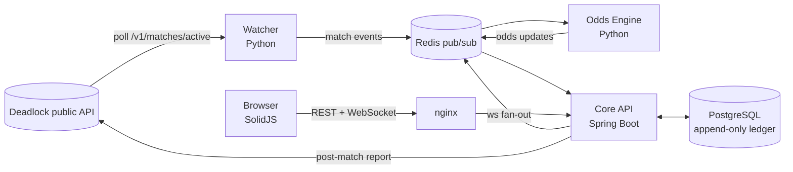

# Naebka

Live betting on real public **Deadlock** matches, plus **slots** and multiplayer **No-Limit Hold'em**, all on one
token wallet with an append-only ledger. Implementation of the group's design documents in this folder
(High-Level Design, System Architecture, Technical Design, LLD, Database Design, Frontend, Risks).

Runs in **play-money mode**: tokens are free and have no cash value.

## Run it

Requirements: Docker Desktop. Nothing else needs to be installed.

```bash
docker compose up --build
```

Open <http://localhost:8080>, register (18+, licensed country), and you start with 1,000 NTK.
Live matches appear within ~10 s: the watcher picks fresh ranked games from `api.deadlock-api.com`.

| Service | Port (host) | What it is |
|---|---|---|
| `web` | 8080 | SolidJS SPA on nginx; reverse-proxies `/api` and `/ws` to `core` |
| `core` | 8081 | Spring Boot API (Swagger UI: <http://localhost:8081/api/docs>) |
| `postgres` | 55432 | PostgreSQL 17 (non-default port so it doesn't clash with a local install) |
| `redis` | 56379 | Redis 7: message broker and WebSocket fan-out |
| `watcher` | – | Python: polls the Deadlock API and publishes normalized match events |
| `odds-engine` | – | Python: prices markets from the event stream |

The admin account (manual-review queue and integrity dashboard at `/admin`) comes from `.env.example`
(`NAEBKA_ADMIN_USERNAME` / `NAEBKA_ADMIN_PASSWORD`). Copy it to `.env` to change values.

## Architecture



* **Transactional core** (modular monolith): auth, wallet/ledger, responsible gambling, live betting, settlement
  worker, slots, poker, chat, WebSocket hub. Packages only touch money through `WalletService`.
* **Event-driven live data**: the watcher knows nothing about odds or money; the odds engine knows nothing about
  users. Everything Deadlock-specific lives in `live/naebka_live/deadlock_api.py` + `watcher.py`.

### The live-betting loop

1. **Discover**: the watcher keeps up to 8 fresh Normal-mode matches (best rank first), and re-announces them every
   minute so a restarted core picks them up.
2. **Ingest**: each 10 s poll is diffed into `objective.destroyed`, `networth.swing`, `match.ended` or
   `match.snapshot`.
3. **Suspend first**: on a state-changing event the core immediately moves every OPEN market to SUSPENDED.
4. **Reprice**: the odds engine waits a 5 s cooling-off, prices the new state and publishes. The core writes
   `odds_history` and reopens the market (plausibility band 1.01–51.0, otherwise it stays suspended).
5. **Bet**: `POST /api/bets` re-validates after a 1.5 s acceptance delay under a row lock. If the price moved you
   get `409 PRICE_CHANGED` (or the bet takes the better price if you allowed higher odds).
6. **Settle**: when the match ends, the settlement worker fetches `/v1/matches/{id}/metadata`. If it agrees with the
   stream, payouts go to the ledger. On a mismatch or data-quality flag, or if no report arrives within 3 h, the
   match goes to the manual-review queue.
7. **Watchdogs**: no watcher data for 60 s → STALE and suspended. Stale for 20 min → ended and settled from the
   report.

## Tests

```bash
# Java: 41 unit tests (poker rules, hand evaluator, side pots, slot RTP simulation, provable fairness, money)
cd core && mvn test
# + 14 integration tests on real Postgres/Redis containers (Testcontainers; needs Docker)
cd core && mvn -Pit test

# Python: 21 tests, mypy --strict
cd live && python -m venv .venv && .venv/Scripts/pip install -e ".[dev]"   # bin/ on Linux/macOS
.venv/Scripts/python -m pytest && .venv/Scripts/python -m mypy naebka_live tests

# Frontend (no local Node needed)
docker run --rm -v "$PWD/frontend:/app" -w /app node:22-alpine sh -c "npm install && npx tsc --noEmit && npx vp lint src && npm run build"
```

What the integration tests prove (Definition of Done: "end-to-end simulated match flows: place, suspend, reprice,
settle" via the scripted `MatchSimulator`):

* **Full match flow**: place, then suspend on an event, then `MARKET_SUSPENDED`, then reprice, then `PRICE_CHANGED`,
  then end, then auto-settle and pay out.
* Stream/report disagreement → `REVIEW`; void → stakes refunded.
* 40 concurrent debits on one wallet → exactly 20 succeed, balance never negative, ledger sum = balance.
* Idempotency keys move money once; the ledger rejects `UPDATE`/`DELETE`.
* HTTP: RFC 7807 errors, logout revokes the JWT, slot spin is verifiable after seed rotation, poker buy-in/cash-out.

## Where each design document lives in the code

| Spec | Implementation |
|---|---|
| DB design: 24 tables, 3NF, CHECKs, partial indexes | `core/src/main/resources/db/migration/V1__schema.sql` (extra tables are marked `[ADDED]` with the doc that requires them) |
| Append-only ledger, atomic conditional debit (LLD §2.1, Risk #7) | `wallet/WalletService.java`: DB triggers forbid ledger edits |
| LLD exception hierarchy and resolutions | `common/Exceptions.java`, `common/ErrorCode.java` (HTTP + WS codes 1001–1005), `common/TxRetry.java` (100/300/500 ms retry → 503) |
| RFC 7807 errors, Idempotency-Key, cursor pagination | `common/GlobalExceptionHandler.java`, `common/Cursor.java` |
| JWT (never in URLs), bcrypt, sessions, lockout (Risk #2) | `auth/*`: the WebSocket authenticates with its first message, not a query string |
| Suspend-then-reprice, odds_history, plausibility watchdog | `live/MatchService.java`, `live/BetService.java` |
| Settlement reconciliation + manual review | `live/SettlementService.java`, `live/DeadlockReportClient.java` (circuit breaker), `/admin` |
| BettingEngine UML | `live/*`; markets are DB-driven (match winner, duration over/under 30:00) |
| Slot machine UML (SlotMachine, Reel, Paytable, Payline, ProvablyFairRNG, BonusGame, JackpotPool…) | `slots/*` |
| Poker UML (PokerTable, Player, Deck, HandEvaluator, PotManager, Pot…) | `poker/*`: one actor thread per table |
| Hole-card masking, same-IP restriction (LLD §2.1) | `PokerTable.publicState()` / `privateState()`, `PokerService.sit()` |
| WebSocket `{topic, seq, ts, data}` with `lastSeq` resume | `ws/WsHub.java`, `ws/NaebkaWebSocketHandler.java`, `frontend/src/lib/ws.ts` |
| Responsible gambling (Risk #4) | `wallet/ResponsibleGamingService.java`: deposit/wager/loss limits, 24 h cooling-off on increases, self-exclusion |
| CURRENCY_MODE compliance gate (Risk #13) | `config/CurrencyModeGuard.java`: REAL_MONEY refuses to start without the license sign-off file |
| Frontend stack (Vite+, SolidJS, TS, Tailwind, TanStack, openapi-typescript, component registry) | `frontend/`; API types generated into `src/api/schema.d.ts` (`npm run gen:api`), shared components in `src/components/ui.tsx` |

## Decisions and deviations from the documents

Where the documents disagreed or left things open, this is what was built and why.

| Topic | Documents say | Built | Why |
|---|---|---|---|
| Odds model | LLD: pari-mutuel; Technical Design: heuristic fixed odds | Heuristic fixed odds with suspend-then-reprice | Matches the architecture and risk docs (courtsiding defense needs fixed prices) |
| Payments | Architecture: PSP webhooks; DB: Bitcoin; DoD: play money | Play-money deposit/withdraw endpoints; `btc_payments` table exists but is unused | No licence; the DoD milestone is play money |
| Login | Steam OpenID + email/password | Username/password + JWT; `/api/auth/steam` returns 501 | Steam needs a public return URL; insider-betting check (`BETTOR_IS_PARTICIPANT`) depends on it |
| Games | CS2 + Deadlock | Deadlock only; `cs2` row exists, inactive | Only Deadlock has a data source |
| Watcher fleet | Supervisor + many watchers | One watcher process + core watchdogs (STALE, heartbeat) | MVP scale (≤ 8 matches); same event contract, so it can be split later |
| Slots / poker transport | LLD: WebSocket controllers | Slots over REST (a spin is one atomic request); poker actions over WebSocket (REST also available) | Simpler, same guarantees |
| Money type | LLD: `BigDecimal` | `long` minor units (DB design: "minor units") | Exact integer arithmetic; API still speaks decimal tokens |
| Settlement when stream lost the winner | Strict agreement required | Settles from the official report alone if the stream has no winner; any *disagreement* still goes to review | The public API usually drops a match before showing its winner; strict mode would send almost every match to review |
| Accept higher odds | – | Opt-in on the bet slip (default on) | Live prices drift every few seconds; price drops still need reconfirmation |
| Frontend tests | – | Type-check + Vite+ lint; no component tests yet | Time; backend logic is covered |

## Known gaps (not built)

* Real-money rails (PSP, KYC/AML, geo-IP checks, withdrawal review queue) — the compliance gate blocks REAL_MONEY.
* Steam OpenID, 2FA, insider-betting cross-check.
* Reality-check reminders, first-withdrawal delay, chargeback / negative-balance policy (Risk #12).
* Kubernetes deployment, load tests, SonarQube/CI pipeline.
* Poker: no rebuy/top-up (leave and sit again), no run-it-twice; slot "SlotEventListener" is not used.
